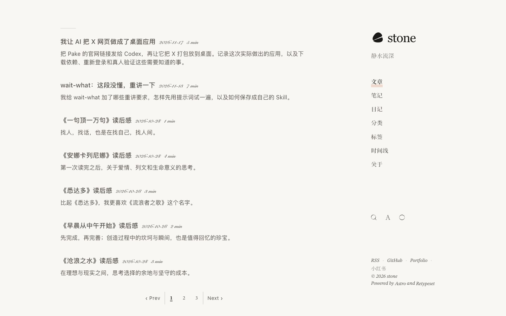
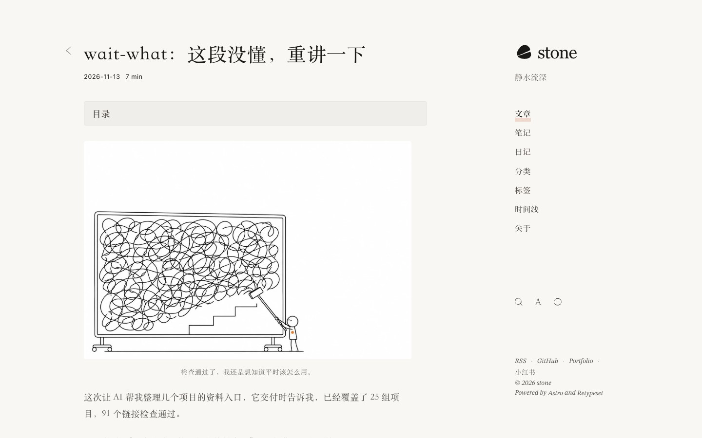

<div align="center">

# stone · 独立博客

**静水流深——记录读书笔记、生活随笔，以及和 AI 一起折腾工作流的真实过程。**

<p>
  <a href="https://blog.heystone.site/"><strong>阅读博客 ↗</strong></a> ·
  <a href="https://heystone.site/">个人网站</a> ·
  <a href="https://blog.heystone.site/rss.xml">RSS</a> ·
  <a href="#english">English</a>
</p>

<br />



</div>

## 这里写些什么

把过程写下来，是我消化世界的方式。目前站点已公开发布 **20 篇文章**，分为三条线索：

- **AI 实践与工作流**：从真实需求出发的实战记录与可复用起步包——包括《用 Obsidian 打造你的第二大脑》、《`wait-what`：这段没懂，重讲一下》（附 Skill 下载与页内互动角色「小橙」）、《我让 AI 把 X 网页做成了桌面应用》以及《和 AI 一起走过的半年》。
- **读书笔记**：读完后劲很长的书，留一段诚实的回声——《活着》《悉达多》《安娜卡列尼娜》《窄门》《一句顶一万句》《早晨从中午开始》《沧浪之水》《项塔兰》。
- **日常随笔**：关于看戏、播客、夏天与学习本身的安静片段。

## 阅读与插画气质

|  |  |
| :---: | :---: |
| *暖纸白留白排印，基于 Astro 与 Retypeset Odyssey 定制* | *每篇文章配独立绘制的细黑线 + 陶土橙点缀插画* |

## 快速开始

使用 Astro 与 `pnpm` 构建：

```bash
git clone https://github.com/nuts-and-bytes/stone-blog.git
cd stone-blog
corepack pnpm install --frozen-lockfile
corepack pnpm dev
```

<details>
<summary><strong>内容目录、校验命令与部署说明</strong></summary>

<br />

- **内容目录**：
  - `content/posts/`：正式文章（中文为源语言，缺失译文时自动回退至中文）
  - `content/notes/`、`content/journals/`、`content/about/`：笔记、日记与关于页
  - `public/images/illustrations/`：文章插画 WebP 素材
  - `public/downloads/`：随文附带的 Skill 与起步包下载
- **构建与检查**：
  ```bash
  corepack pnpm test:unit
  corepack pnpm build
  corepack pnpm test:artifacts
  corepack pnpm test:e2e
  ```
- **部署与主题许可**：推送到 `main` 后由 GitHub Actions 自动构建并发布至 <https://blog.heystone.site/>。博客基于 Retypeset Odyssey / Astro Theme Retypeset（MIT License），详见 [THEME_UPSTREAM.md](THEME_UPSTREAM.md) 与 [LICENSE](LICENSE)。

</details>

## English

Source repository for **[blog.heystone.site](https://blog.heystone.site/)** — **stone's** personal blog built with Astro and a customized Retypeset Odyssey theme, featuring reading notes, personal essays, hands-on AI workflow guides, custom fine-line orange-accent illustrations, and downloadable starter kits/skills.

Run locally with `corepack pnpm install --frozen-lockfile && corepack pnpm dev`. Pushing to `main` deploys automatically via GitHub Actions.

---

<p align="center">made by <a href="https://heystone.site/">stone</a> · 为 AI 世界留一点人味</p>
